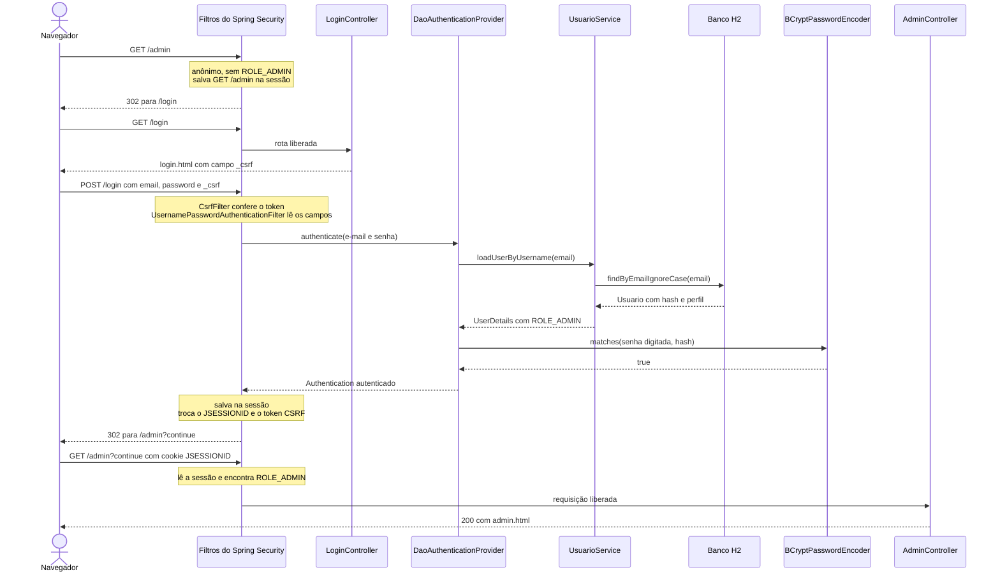

# Guia Completo: Login com Spring Security

Este guia explica como funciona o login do Torresmo Delivery: onde ficam os usuários, como a senha é conferida, o que o Spring Security faz em cada requisição e como a aplicação decide quem pode abrir a área administrativa.

Pré-requisito: conhecer controllers, Thymeleaf e Spring Data JPA, que já aparecem no restante do projeto.

## Visão geral

A aplicação tem dois perfis de usuário:

| Perfil    | Como é criado                                     | O que pode acessar                                         |
| --------- | ------------------------------------------------- | ---------------------------------------------------------- |
| `CLIENTE` | A própria pessoa se cadastra em `/registro`       | As páginas públicas. Ainda não há página exclusiva de cliente. |
| `ADMIN`   | Criado automaticamente quando a aplicação inicia  | As páginas públicas e a área `/admin`                      |

Só as rotas que começam com `/admin` exigem login. As demais (`/`, `/produtos`, `/carrinho`, `/login`, `/registro`, `/h2-console`) continuam abertas a qualquer pessoa.

A ideia mais importante deste guia: **nenhum controller do projeto processa o login**. Não existe `@PostMapping("/login")`. Quem confere o e-mail e a senha é o Spring Security, por meio de filtros que rodam antes de a requisição chegar aos controllers.

## Arquivos envolvidos

```text
src/main/java/com/professorangoti/torresmo/
├── config/SecurityConfig.java          # Regras de acesso, página de login, logout e PasswordEncoder
├── model/Usuario.java                  # Entidade da tabela usuario
├── model/Perfil.java                   # Enum ADMIN / CLIENTE
├── repository/UsuarioRepository.java   # Busca usuário por e-mail
├── service/UsuarioService.java         # Liga o banco ao Spring Security e cadastra clientes
├── dto/RegistroForm.java               # Campos e validações do formulário de cadastro
├── controller/LoginController.java     # Só exibe a página de login (GET /login)
├── controller/RegistroController.java  # Exibe e processa o cadastro
└── TorresmoApplication.java            # Cria o usuário admin na inicialização

src/main/resources/templates/
├── login.html
├── registro.html
└── fragments/navbar.html               # Mostra Entrar / Sair e os links de admin
```

Dependências acrescentadas ao `pom.xml`:

| Dependência                        | Para que serve                                         |
| ---------------------------------- | ------------------------------------------------------ |
| `spring-boot-starter-security`     | O Spring Security                                      |
| `thymeleaf-extras-springsecurity6` | Atributos `sec:` nos templates                         |
| `spring-boot-starter-validation`   | Anotações `@NotBlank`, `@Email` e outras no cadastro   |

## 1. A tabela de usuários

```java
@Entity
@Data
@NoArgsConstructor
public class Usuario {
  @Id
  @GeneratedValue(strategy = GenerationType.IDENTITY)
  private Long idUsuario;

  @Column(nullable = false)
  private String nome;

  @Column(nullable = false, unique = true)
  private String email;

  @ToString.Exclude
  @Column(nullable = false)
  private String senha;

  @Enumerated(EnumType.STRING)
  @Column(nullable = false)
  private Perfil perfil;
}
```

**Características:**

- `email` é `unique`: o banco recusa dois usuários com o mesmo e-mail. É o e-mail que a pessoa digita para entrar.
- `senha` guarda o hash da senha. A senha digitada nunca é gravada.
- `@Enumerated(EnumType.STRING)` grava o texto `ADMIN` ou `CLIENTE`. Sem essa anotação, o JPA gravaria a posição no enum (0 ou 1), e reordenar o enum trocaria o perfil de quem já está cadastrado.
- `@ToString.Exclude` tira a senha do `toString()` gerado pelo Lombok, para o hash não aparecer em logs.

Com `spring.jpa.hibernate.ddl-auto=update`, o Hibernate criou a tabela na primeira execução:

```sql
create table usuario (
    id_usuario bigint generated by default as identity,
    email varchar(255) not null,
    nome varchar(255) not null,
    perfil enum ('ADMIN','CLIENTE') not null,
    senha varchar(255) not null,
    primary key (id_usuario)
)
```

Ele também criou uma restrição `unique (email)`.

### Como a senha é guardada: BCrypt

O `SecurityConfig` declara o codificador de senhas da aplicação:

```java
@Bean
public PasswordEncoder passwordEncoder() {
    return new BCryptPasswordEncoder();
}
```

`passwordEncoder.encode("admin123")` devolve um texto de 60 caracteres dividido assim:

| Trecho                    | Significado                                              |
| ------------------------- | -------------------------------------------------------- |
| `$2a$`                    | Versão do algoritmo BCrypt                               |
| `10$`                     | Custo: o cálculo é repetido 2¹⁰ = 1.024 vezes            |
| 22 caracteres seguintes   | Salt: valor aleatório gerado a cada chamada de `encode`  |
| 31 caracteres finais      | O hash calculado a partir da senha e do salt             |

Disso resultam duas propriedades importantes:

1. **A mesma senha gera hashes diferentes** a cada `encode`, porque o salt muda. Por isso a senha não pode ser conferida com `equals`. O método certo é `passwordEncoder.matches(senhaDigitada, hashDoBanco)`: ele lê o salt de dentro do hash, refaz o cálculo com a senha digitada e compara os resultados.
2. **O cálculo é lento de propósito.** Para quem faz login, a demora é imperceptível. Para quem roubou o banco e quer testar milhões de senhas, ela encarece muito o ataque.

A seção 10 mostra como ver os hashes reais no H2 Console.

## 2. Como os usuários chegam ao banco

### O administrador

`TorresmoApplication` tem um `CommandLineRunner` que roda toda vez que a aplicação sobe. Ele cria o admin se ainda não existir um usuário com esse e-mail:

```java
@Bean
CommandLineRunner initAdmin(UsuarioRepository usuarioRepository, PasswordEncoder passwordEncoder) {
    return args -> {
        if (!usuarioRepository.existsByEmailIgnoreCase("admin@torresmo.com")) {
            Usuario admin = new Usuario();
            admin.setNome("Administrador");
            admin.setEmail("admin@torresmo.com");
            admin.setSenha(passwordEncoder.encode("admin123"));
            admin.setPerfil(Perfil.ADMIN);
            usuarioRepository.save(admin);
        }
    };
}
```

Credenciais: **admin@torresmo.com / admin123**. Num projeto didático, deixar essa senha no código é aceitável. Em produção, ela viria de uma variável de ambiente.

### Os clientes: cadastro em `/registro`

1. **`GET /registro`**: `RegistroController.formulario` coloca um `RegistroForm` vazio no model e devolve `registro.html`.
2. **`POST /registro`**: o Spring preenche o `RegistroForm` com os campos enviados, e o `@Valid` aplica as anotações da classe:

   | Campo   | Anotações                         | Mensagem quando falha                        |
   | ------- | --------------------------------- | -------------------------------------------- |
   | `nome`  | `@NotBlank`, `@Size(max = 100)`   | "Informe seu nome"                           |
   | `email` | `@NotBlank`, `@Email`             | "Informe um e-mail válido"                   |
   | `senha` | `@NotNull`, `@Size(min = 6)`      | "A senha deve ter pelo menos 6 caracteres"   |

3. O controller faz duas verificações que as anotações não cobrem:

   ```java
   if (!Objects.equals(registroForm.getSenha(), registroForm.getConfirmacaoSenha())) {
     result.rejectValue("confirmacaoSenha", "senha.diferente", "As senhas não conferem");
   }
   if (!result.hasFieldErrors("email") && usuarioService.emailJaCadastrado(registroForm.getEmail())) {
     result.rejectValue("email", "email.duplicado", "Este e-mail já está cadastrado");
   }
   ```

   A consulta de e-mail duplicado só roda quando o e-mail já passou nas outras validações, para não ir ao banco com um e-mail inválido.

4. Se houver erro, o controller devolve `registro.html` com as mensagens. No template, `th:errorclass="is-invalid"` deixa o campo vermelho e `th:errors` mostra o texto.
5. Sem erros, `UsuarioService.registrarCliente` grava o usuário:

   ```java
   public Usuario registrarCliente(RegistroForm form) {
     Usuario usuario = new Usuario();
     usuario.setNome(form.getNome().trim());
     usuario.setEmail(form.getEmail().trim().toLowerCase());
     usuario.setSenha(passwordEncoder.encode(form.getSenha()));
     usuario.setPerfil(Perfil.CLIENTE);
     return usuarioRepository.save(usuario);
   }
   ```

   O e-mail é gravado em minúsculas, a senha passa pelo BCrypt e o perfil é sempre `CLIENTE`.

6. O navegador é redirecionado para `/login?registrado`, onde aparece "Conta criada! Entre com seu e-mail e senha.". O cadastro não faz login automático.

**Por que usar um `RegistroForm` em vez de receber `Usuario` direto no controller?**

- O formulário tem o campo `confirmacaoSenha`, que não é coluna da tabela.
- Se o controller recebesse um `Usuario`, alguém poderia acrescentar `perfil=ADMIN` ao POST e o Spring preencheria esse campo, criando um administrador. O `RegistroForm` não tem campo `perfil`, então o perfil é sempre decidido pelo servidor.

## 3. A configuração: `SecurityConfig`

```java
@Configuration
@EnableWebSecurity
public class SecurityConfig {

    @Bean
    public SecurityFilterChain filterChain(HttpSecurity http) throws Exception {
        http
            .authorizeHttpRequests(auth -> auth
                .requestMatchers("/admin/**").hasRole("ADMIN")
                .anyRequest().permitAll()
            )
            .formLogin(form -> form
                .loginPage("/login")
                .usernameParameter("email")
                .defaultSuccessUrl("/")
                .permitAll()
            )
            .logout(logout -> logout
                .logoutUrl("/logout")
                .logoutSuccessUrl("/")
                .permitAll()
            )
            .headers(headers -> headers
                .frameOptions(frame -> frame.sameOrigin())
            )
            .csrf(csrf -> csrf
                .ignoringRequestMatchers("/h2-console/**")
            );

        return http.build();
    }

    @Bean
    public PasswordEncoder passwordEncoder() {
        return new BCryptPasswordEncoder();
    }
}
```

### `authorizeHttpRequests`: quem pode acessar o quê

As regras são avaliadas na ordem em que aparecem, e a primeira que casa com a URL decide.

- `requestMatchers("/admin/**").hasRole("ADMIN")`: `/**` casa com `/admin`, `/admin/inline`, `/admin/produtos/5/delete` e qualquer outro caminho abaixo de `/admin`.
- `anyRequest().permitAll()`: todo o resto fica liberado. O Spring Security exige que `anyRequest()` seja a última regra e recusa iniciar a aplicação se ela vier antes de outra.
- `hasRole("ADMIN")` procura a autoridade `ROLE_ADMIN`. O prefixo `ROLE_` é acrescentado ao carregar o usuário (passo 4 da seção 5).

### `formLogin`: o login por formulário

| Configuração                | Efeito                                                                                                                                       |
| --------------------------- | -------------------------------------------------------------------------------------------------------------------------------------------- |
| `loginPage("/login")`       | Usa a nossa página em vez da página padrão do Spring Security. `GET /login` vai para o `LoginController`; `POST /login` é processado pelo filtro de login. |
| `usernameParameter("email")`| O filtro lê o campo `email` do formulário. Sem essa linha, ele procuraria um campo `username`. O campo da senha mantém o nome padrão, `password`. |
| `defaultSuccessUrl("/")`    | Destino depois do login quando não há uma página salva para retomar (passo 5 da seção 5).                                                  |
| `permitAll()`               | Libera a página de login para quem não está logado.                                                                                          |

Como não configuramos uma URL de falha, o Spring Security usa a padrão: `/login?error`.

### `logout`

`POST /logout` encerra a sessão e redireciona para `/`. A seção 8 explica os detalhes.

### `headers` e `csrf`: exceções para o H2 Console

O H2 Console é montado com frames HTML e envia formulários próprios, sem token CSRF. Por padrão, o Spring Security proíbe que a aplicação seja exibida dentro de frames e exige o token em todo POST, e as duas coisas quebrariam o console.

- `frameOptions(frame -> frame.sameOrigin())` permite frames vindos da própria aplicação.
- `ignoringRequestMatchers("/h2-console/**")` desliga a verificação CSRF apenas nas URLs do console.

Essas duas linhas existem só por causa do console.

### Onde o `UsuarioService` entra?

O `SecurityConfig` não menciona o `UsuarioService`. Na inicialização, o Spring Security procura no contexto um único bean que implemente `UserDetailsService` e um bean `PasswordEncoder`, e monta o mecanismo de autenticação com os dois. O log de inicialização confirma:

```text
Global AuthenticationManager configured with UserDetailsService bean with name usuarioService
```

Se existissem dois beans `UserDetailsService`, o Spring Security não escolheria nenhum e registraria um aviso no log.

## 4. A cadeia de filtros

Toda requisição passa por uma sequência de filtros de servlet antes de chegar ao `DispatcherServlet` e aos controllers. Esta é a cadeia desta aplicação, na ordem de execução:

```text
DisableEncodeUrlFilter
WebAsyncManagerIntegrationFilter
SecurityContextHolderFilter
HeaderWriterFilter
CsrfFilter
LogoutFilter
UsernamePasswordAuthenticationFilter
RequestCacheAwareFilter
SecurityContextHolderAwareRequestFilter
AnonymousAuthenticationFilter
ExceptionTranslationFilter
AuthorizationFilter
```

Os que participam do login:

| Filtro                                  | Papel                                                                                     |
| --------------------------------------- | ----------------------------------------------------------------------------------------- |
| `SecurityContextHolderFilter`           | Carrega da sessão HTTP quem está logado                                                   |
| `HeaderWriterFilter`                    | Escreve cabeçalhos de segurança na resposta, como o `X-Frame-Options`                     |
| `CsrfFilter`                            | Rejeita POST sem token CSRF válido                                                        |
| `LogoutFilter`                          | Processa `POST /logout`                                                                   |
| `UsernamePasswordAuthenticationFilter`  | Processa `POST /login`                                                                    |
| `RequestCacheAwareFilter`               | Retoma a requisição que foi salva antes do login                                          |
| `AnonymousAuthenticationFilter`         | Quando ninguém está logado, registra a requisição como anônima                            |
| `ExceptionTranslationFilter`            | Quando o acesso é negado, manda o visitante para o login ou responde 403                  |
| `AuthorizationFilter`                   | Aplica as regras de `authorizeHttpRequests`                                               |

A cadeia não tem o `DefaultLoginPageGeneratingFilter`, que gera a página de login padrão do Spring Security. Ele sai da cadeia porque configuramos `loginPage("/login")`.

Para ver essa lista no log de inicialização, acrescente ao `application.properties`:

```properties
logging.level.org.springframework.security.web.DefaultSecurityFilterChain=DEBUG
```

## 5. Passo a passo de um login

Cenário: um visitante sem login abre `/admin` e entra como administrador.



### Passo 1: o acesso a `/admin` é negado

1. `SecurityContextHolderFilter` procura um usuário na sessão e não encontra nenhum.
2. `AnonymousAuthenticationFilter` registra a requisição como anônima.
3. `AuthorizationFilter` aplica a regra de `/admin/**`, que exige `ROLE_ADMIN`. O anônimo não tem essa autoridade, então o filtro lança `AccessDeniedException`.
4. `ExceptionTranslationFilter` captura a exceção. Como o visitante é anônimo, ele guarda a requisição `GET /admin` na sessão e responde **302** para `/login`.

### Passo 2: a página de login

`GET /login` está liberado, então a requisição chega ao `LoginController`, que só devolve o template:

```java
@GetMapping("/login")
public String login() {
    return "login";
}
```

O formulário em `login.html`:

```html
<form th:action="@{/login}" method="post">
  <input type="email" id="email" name="email" required autofocus />
  <input type="password" id="password" name="password" required />
  <button type="submit">Entrar</button>
</form>
```

- Os atributos `name` precisam bater com a configuração: `email`, por causa do `usernameParameter("email")`, e `password`, o nome padrão.
- Por causa do `th:action`, o Thymeleaf acrescenta ao formulário um campo oculto com o token CSRF:

  ```html
  <input type="hidden" name="_csrf" value="..."/>
  ```

### Passo 3: o envio do formulário

O navegador envia `POST /login` com `email`, `password` e `_csrf`.

1. `CsrfFilter` compara o `_csrf` recebido com o token guardado na sessão. Se faltar ou for diferente, a resposta é **403**.
2. `UsernamePasswordAuthenticationFilter` reconhece `POST /login`. Quando só `loginPage` é configurado, o Spring Security usa a mesma URL para receber o POST. O filtro lê `email` e `password`, monta um `UsernamePasswordAuthenticationToken` ainda não autenticado e o entrega ao `AuthenticationManager`.

A requisição termina aqui e nunca chega ao `DispatcherServlet`. Por isso o `LoginController` só tem o método GET.

### Passo 4: a conferência das credenciais

O `AuthenticationManager` repassa o trabalho ao `DaoAuthenticationProvider`, o componente que busca o usuário numa fonte de dados por meio de um `UserDetailsService`.

**4a. Busca do usuário.** O provider chama o `UsuarioService`:

```java
@Override
public UserDetails loadUserByUsername(String email) throws UsernameNotFoundException {
  Usuario usuario = usuarioRepository.findByEmailIgnoreCase(email.trim())
      .orElseThrow(() -> new UsernameNotFoundException("Usuário não encontrado: " + email));

  return User.withUsername(usuario.getEmail())
      .password(usuario.getSenha())
      .roles(usuario.getPerfil().name())
      .build();
}
```

- O Spring Security chama o identificador de *username*. Nesta aplicação, ele é o e-mail.
- `findByEmailIgnoreCase` gera `where upper(email) = upper(?)`, então `Maria@Teste.com` e `maria@teste.com` encontram o mesmo usuário.
- O método converte o `Usuario` (nossa entidade) em `UserDetails` (a classe de usuário do Spring Security).
- `roles("ADMIN")` cria a autoridade `ROLE_ADMIN`. É daqui que vem o prefixo que o `hasRole("ADMIN")` procura.
- Se o e-mail não existir, o método lança `UsernameNotFoundException`.

**4b. Conferência da senha.** O provider chama `passwordEncoder.matches(senhaDigitada, userDetails.getPassword())`, como descrito na seção 1.

**4c. Resultado.** Se a senha confere, o provider devolve um novo `Authentication`, marcado como autenticado e com as autoridades do usuário (`[ROLE_ADMIN]`). Em seguida, o `AuthenticationManager` apaga a senha desse objeto para que ela não fique guardada na memória nem na sessão.

**E-mail inexistente e senha errada recebem a mesma resposta.** O `DaoAuthenticationProvider` converte a `UsernameNotFoundException` em `BadCredentialsException`. Nos dois casos o navegador vai para `/login?error` e vê a mesma mensagem, e assim a página de login não revela quais e-mails estão cadastrados. O texto da `UsernameNotFoundException` nunca chega ao usuário.

O cadastro tem um comportamento diferente: ele avisa "Este e-mail já está cadastrado". Muitos sites fazem essa troca, que ajuda quem esqueceu que já tinha conta, mas revela que aquele e-mail existe.

### Passo 5: login aceito

O `UsernamePasswordAuthenticationFilter` conclui o login:

1. Guarda o `Authentication` no `SecurityContext` e salva o `SecurityContext` na sessão HTTP.
2. Troca o ID da sessão: o navegador recebe um cookie `JSESSIONID` novo. Isso protege contra *session fixation*: se alguém tivesse plantado um ID de sessão no navegador da vítima antes do login, esse ID deixa de valer.
3. Gera um novo token CSRF.
4. Redireciona o navegador:
   - Havia uma requisição salva no passo 1, então a resposta é **302** para `/admin?continue`.
   - Se a pessoa tivesse clicado em "Entrar" direto, sem requisição salva, o destino seria o `defaultSuccessUrl`, ou seja, `/`.

O parâmetro `?continue` avisa ao `RequestCacheAwareFilter` que há uma requisição salva na sessão para retomar. Sem esse parâmetro, o filtro não consulta a sessão.

### Passo 5 (alternativo): login recusado

O navegador recebe **302** para `/login?error`, e o `login.html` mostra a mensagem:

```html
<div th:if="${param.error}" class="alert alert-danger" role="alert">
  E-mail ou senha incorretos.
</div>
```

`param` dá acesso aos parâmetros da URL. A presença de `?error`, mesmo sem valor, basta para o `th:if` exibir a mensagem.

### Passo 6: as próximas requisições

A cada requisição, o navegador envia o cookie `JSESSIONID`. O `SecurityContextHolderFilter` usa esse cookie para carregar o `SecurityContext` da sessão, e o `AuthorizationFilter` encontra `ROLE_ADMIN` e libera o acesso ao `AdminController`.

A sessão vale até o logout ou até 30 minutos sem atividade, o padrão do Spring Boot (propriedade `server.servlet.session.timeout`). Ao fechar o navegador, o cookie de sessão normalmente é descartado.

## 6. ADMIN e CLIENTE: autorização

Respostas observadas ao testar a aplicação:

| Situação                                              | Resposta                    |
| ----------------------------------------------------- | --------------------------- |
| Visitante abre `/admin`                               | 302 para `/login`           |
| Login com senha errada                                | 302 para `/login?error`     |
| Cliente faz login                                     | 302 para `/`                |
| Cliente logado abre `/admin`                          | 403 Forbidden               |
| Admin faz login logo depois de tentar abrir `/admin`  | 302 para `/admin?continue`  |
| Admin logado abre `/admin`                            | 200 OK                      |

O visitante e o cliente são barrados pela mesma regra e recebem respostas diferentes. Quem decide é o `ExceptionTranslationFilter`:

- **Anônimo:** talvez a pessoa tenha uma conta, então ele a manda para o login.
- **Autenticado sem permissão:** entrar de novo não mudaria nada, então ele responde 403.

O 403 aparece na página de erro padrão do Spring Boot. Para personalizá-la, crie o template `templates/error/403.html`.

## 7. A navbar e o usuário logado

O `thymeleaf-extras-springsecurity6` adiciona atributos `sec:` aos templates. É preciso declarar o namespace:

```html
<html xmlns:th="http://www.thymeleaf.org"
      xmlns:sec="http://www.thymeleaf.org/extras/spring-security">
```

Trecho da `navbar.html`:

```html
<li class="nav-item" sec:authorize="hasRole('ADMIN')">
  <a class="nav-link" th:href="@{/admin}">Administrador</a>
</li>
...
<li class="nav-item" sec:authorize="!isAuthenticated()">
  <a class="btn btn-outline-light btn-sm" th:href="@{/login}">Entrar</a>
</li>
<li class="nav-item" sec:authorize="isAuthenticated()">
  <form th:action="@{/logout}" method="post" class="d-inline">
    <button type="submit" class="btn btn-outline-light btn-sm">
      Sair (<span sec:authentication="name"></span>)
    </button>
  </form>
</li>
```

| Atributo                                | Efeito                                              |
| --------------------------------------- | --------------------------------------------------- |
| `sec:authorize="hasRole('ADMIN')"`      | Mostra o elemento só para administradores           |
| `sec:authorize="isAuthenticated()"`     | Mostra o elemento só para quem está logado          |
| `sec:authorize="!isAuthenticated()"`    | Mostra o elemento só para visitantes                |
| `sec:authentication="name"`             | Escreve o username, que nesta aplicação é o e-mail  |

**Esconder o link não protege a página.** A proteção está no `SecurityConfig`. Um cliente que digitar `/admin` na barra de endereço recebe 403, como mostra a tabela da seção 6.

## 8. Logout

O botão "Sair" é um formulário `POST /logout`, e não um link. Com a proteção CSRF ligada, o Spring Security só aceita logout por POST com token. Se um GET bastasse, qualquer site poderia incluir `` e desconectar o usuário sem ele perceber.

O `LogoutFilter` invalida a sessão, limpa o `SecurityContext` e redireciona para `/`, conforme o `logoutSuccessUrl("/")`.

**Observação:** o `login.html` tem uma mensagem para `th:if="${param.logout}"` ("Você saiu da sua conta."). Ela só aparece quando o logout redireciona para `/login?logout`, que é o destino padrão do Spring Security. Como configuramos `logoutSuccessUrl("/")`, essa mensagem nunca é exibida. Para usá-la, troque o destino para `/login?logout` ou remova a linha `logoutSuccessUrl`.

## 9. Proteção CSRF

CSRF (*Cross-Site Request Forgery*) é um ataque em que outro site faz o navegador de um usuário logado enviar uma requisição à nossa aplicação. Exemplo: o administrador está logado e visita uma página maliciosa com um formulário oculto que faz `POST` para `http://localhost:8080/admin/produtos/1/delete` e se envia sozinho. O navegador anexa o cookie de sessão automaticamente e, sem proteção, o produto seria excluído.

A defesa do Spring Security: todo POST precisa trazer um token que o servidor gerou para aquela sessão e que o outro site não tem como ler. O `CsrfFilter` responde 403 a qualquer POST sem o token correto. Requisições GET não são verificadas, e por isso um GET nunca deve alterar dados.

**Quando o token é incluído automaticamente:** em formulários com `th:action`. Todos os formulários do projeto usam `th:action`.

**Quando é preciso incluir à mão:** em formulários montados por JavaScript. O `admin-inline.html` monta o formulário de salvamento em JavaScript e lê o token com o *inlining* de JavaScript do Thymeleaf:

```javascript
const csrfParam = /*[[${_csrf.parameterName}]]*/ "_csrf";
const csrfToken = /*[[${_csrf.token}]]*/ "";

// ao montar o formulário:
dados[csrfParam] = csrfToken;
```

Sem essas linhas, salvar um produto na página "Admin inline" retorna 403.

## 10. Como observar na prática

### Os usuários no banco

1. Com a aplicação rodando, abra <http://localhost:8080/h2-console>.
2. Use a JDBC URL `jdbc:h2:file:./data/torresmo`, o usuário `sa` e deixe a senha em branco.
3. Execute:

   ```sql
   SELECT id_usuario, nome, email, perfil, senha FROM usuario;
   ```

Cadastre duas contas com a mesma senha e compare os hashes da coluna `senha`.

### Cada filtro em ação

Acrescente ao `application.properties`:

```properties
logging.level.org.springframework.security=TRACE
```

Para cada requisição, o log mostra os filtros executados e a decisão de autorização. O volume de log é grande, então remova a linha depois de estudar.

### No navegador

Abra as ferramentas de desenvolvedor (F12), vá à aba **Rede** (*Network*) e marque **Preservar log** (*Preserve log*) para não perder os redirecionamentos. Faça o login e observe:

- os redirecionamentos 302 descritos no passo a passo;
- o cookie `JSESSIONID` mudando depois do login;
- o campo `_csrf` no corpo do `POST /login`.

## Resumo

1. Os usuários ficam na tabela `usuario`, com a senha em BCrypt e o perfil `ADMIN` ou `CLIENTE`.
2. O `SecurityConfig` define que só `/admin/**` exige `ROLE_ADMIN` e que o login é feito pelo formulário de `/login`, com o campo `email`.
3. O `POST /login` é tratado pelo `UsernamePasswordAuthenticationFilter` e nunca chega a um controller.
4. O `DaoAuthenticationProvider` busca o usuário pelo `UsuarioService` e confere a senha com `passwordEncoder.matches`.
5. Com o login aceito, o `Authentication` vai para a sessão HTTP, o `JSESSIONID` é trocado e o navegador volta para a página que tentou abrir.
6. Nas requisições seguintes, o cookie de sessão identifica o usuário e o `AuthorizationFilter` aplica as regras.
